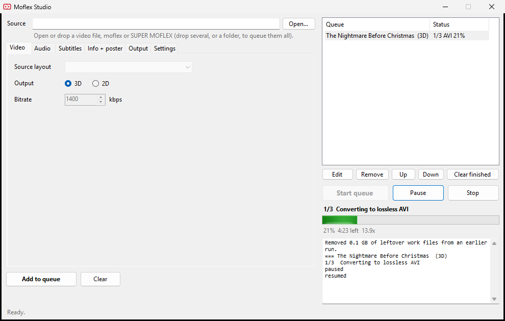
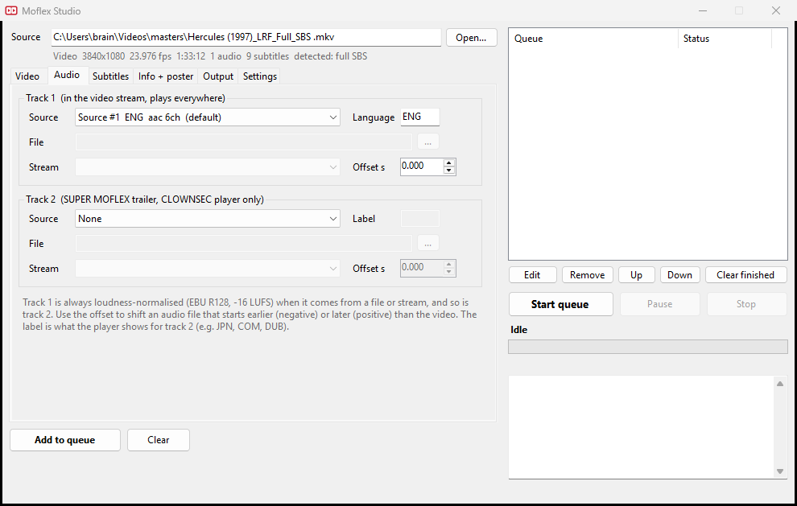
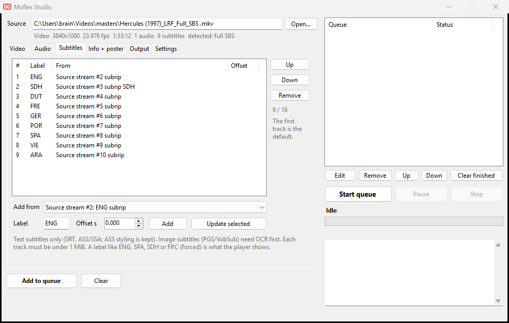
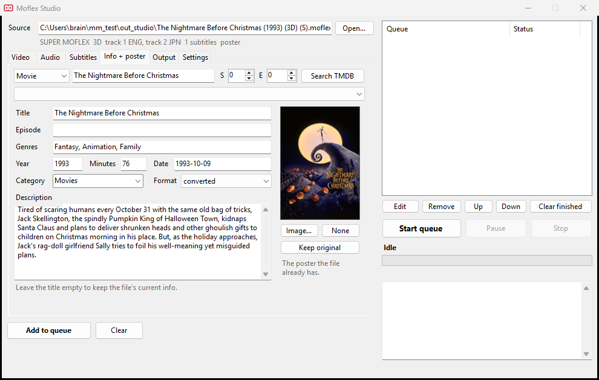
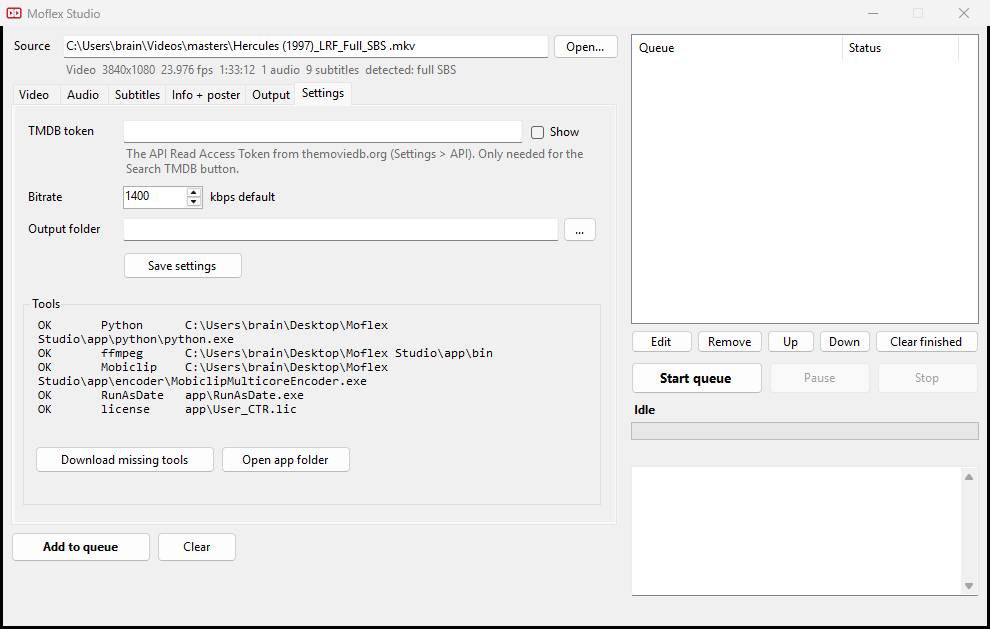

# Moflex Studio

An all-in-one **SUPER MOFLEX** builder for Windows. Give it a video file, a moflex or a SUPER MOFLEX. It produces a 3DS-ready moflex with track 1 audio, up to 7 more audio tracks, up to 3 other versions of the video (e.g. colour and black-and-white), up to 16 subtitle tracks, metadata and a poster. It updates itself from **Settings → Check for updates**.

Special thanks to lenn3 for discovering that raw AVI without audio prevents the moflex encoder hang at 99%, now things are super fast




---

## Contents

- [Install](#install)
- [Updating](#updating)
- [Quick start](#quick-start)
- [What each tab does](#what-each-tab-does)
- [The queue](#the-queue)
- [How long it takes](#how-long-it-takes)
- [Where files go](#where-files-go)
- [Troubleshooting](#troubleshooting)
- [Command line](#command-line)
- [How it works](#how-it-works)
- [Folder layout](#folder-layout)
- [Building the exe](#building-the-exe)
- [Releasing an update](#releasing-an-update)

---

## Install

1. Download **`Moflex.Studio.zip`** from the [Releases page](../../releases) (log in to GitHub first; the repo is private).
2. Unzip it anywhere: Desktop, another drive or a USB stick. Nothing gets installed.
3. Run **`Moflex Studio.exe`**.
   - Windows SmartScreen may say "Windows protected your PC" because the app isn't code-signed. Click **More info → Run anyway**. You only have to do this once.
4. **First launch only:** it downloads two tools on its own, with progress shown in the bottom status bar:
   - **Python 3.11** (embeddable, about 11 MB) from python.org, into `app\python`
   - **ffmpeg** (about 110 MB) from gyan.dev, into `app\bin`

   When the status bar says **Ready**, you're set. If a download fails, go to **Settings → Download missing tools** to retry.
5. *(Optional)* Paste your **TMDB token** into **Settings** and click **Save settings**. It's only needed for the *Search TMDB* button.

Requirements: Windows 10 or 11, 64-bit. It uses the .NET Framework 4.8 that Windows already includes. Free disk space: the temporary lossless AVI is about **8–9 GB for a 90-minute movie**. It goes in your `%TEMP%` folder and is deleted automatically.

To remove it, delete the folder.

---

## Updating

- At every start the app checks for a newer version. When there is one, the status bar says so.
- **Settings → Check for updates** (the button then reads **Update to 1.x**) downloads the new version, checks it, and restarts the app into it. It takes a few seconds.
- Your **settings, queue, Python and ffmpeg are kept**: the update only replaces the app's own files.
- It won't update while the queue is running. Finish or stop the queue first.
- **Coming from 1.2 or older** (no update button yet): download `Moflex.Studio.zip` from the [Releases page](../../releases) once and unzip it over the old folder. Close the app first. After that, updates come through the button.

---

## Quick start

**Fresh video → SUPER MOFLEX**

1. **Open...** a video file, or drag it onto the window. It reads the file and fills in sensible defaults: layout detected, English audio as track 1, every other audio stream as tracks 2, 3 and on, text subtitles, the title and year from the file name, and the minutes from its length.
2. Check the tabs (described below). Usually you only touch **Info + poster** (search TMDB, pick the result).
3. Click **Add to queue**. The editor clears so you can set up the next file.
4. Click **Start queue**.

**Edit an existing moflex or SUPER MOFLEX** (add, remove, reorder or relabel audio tracks and subtitles, add or rename video versions or choose which one is the main version, change the poster or info, fix quiet audio): open it the same way. The video is never re-encoded, so this takes seconds.

**A whole TV season:** set up and queue the first episode (search TMDB as **TV episode** and pick the show). Then drag the rest of the season onto the window: each episode gets the show's info and poster and its own episode title. See *Next episodes* under [Info + poster](#info--poster).

**Batch:** drag **several files or a whole folder** onto the window, or onto the `.exe` icon. Each one is queued with the current Video/Output settings and the defaults above.

---

## What each tab does

### Source line

Shows what was detected:
- **Video files:** resolution, frame rate, length, audio and subtitle counts, and the 3D layout.
- **Moflex files:** 2D/3D, the existing tracks and subtitles, and whether there's a poster.

### Video


| Setting | Meaning |
|---|---|
| **Source layout** | **Auto** (detected), **2D**, **Half SBS** (each eye squeezed to half width) or **Full SBS** (each eye full width). Auto uses the shape of the picture and words like "SBS" in the file name. Set it yourself if Auto guesses wrong. |
| **Output** | **3D** (two 400x240 eyes) or **2D** (one 400x240 picture). 2D output from an SBS source uses the left eye. For a moflex input, this only sets the 3D flag the player reads. |
| **Bitrate** | video bitrate in kbps. 1400 is the default (the official 3D setting). |

The picture is always **letterboxed, never stretched**, so the aspect ratio is kept. Sources above 30 fps are halved (60 → 30).

**Versions of the film** (up to 4 in all, e.g. a colour and a black-and-white master):
- The list starts with **this file's video**. **Row 1 is the main version** (marked *main*): the file's normal video, what every player shows, including the official viewer. The other rows are for the CLOWNSEC player, which switches between them with **VIDEO > Version**.
- **Add file...** a video file (it's encoded exactly like the main one: same 2D/3D output and bitrate) or a moflex (used as it is; it must be the same size and 2D/3D mode). **Layout** is that file's own picture layout, like *Source layout* above.
- **Name** each one, this file's video too, in up to 7 characters (`B&W`, `COLOR`, `IMAX`): select a row, type it and click **Update selected**. That's what the player's Version row shows.
- **A version brings its own audio and subtitles.** When you add a video file, its audio and text subtitle streams appear in the Audio and Subtitles add boxes (labelled *Version N*), and the ones in a language the film doesn't have yet go straight into the lists. They're ordinary tracks that work with every version. Removing the version removes them again.
- **Up / Down** reorder the list. Move a version to row 1 to make it the main one. On a SUPER MOFLEX that only swaps the videos around, without re-encoding. **Remove** drops a version (this file's own video can't be removed).
- All versions must share one timeline: the player switches at the same moment. Each carries the same track 1 audio, so every audio track works with every version.
- Each version adds roughly the main video's size again.

### Audio

| Video file input | Moflex / SUPER MOFLEX input |
|---|---|
|  |  |

- **Track 1** is the in-band audio that plays in **any** moflex player.
  - **Video input:** pick a source stream, **Other file...** (any video or audio file), or **Silent**.
  - **Moflex input:** **Keep as it is**, **Keep, but fix the loudness** (for quiet files), or **Other file...**.
- **Tracks 2–8** are stored in the SUPER MOFLEX trailer. Only the CLOWNSEC player uses them; you switch in its SOUND menu.
  - The list shows them in order. Every other audio stream in a video file is added automatically; a SUPER MOFLEX keeps the tracks it has.
  - To add one, choose it in the box under the list (a track the file already has, a source stream, or **Other file...**), set its **Label** and click **Add track**. Select a row to change it, then **Update selected**. **Up/Down/Remove** manage the list.
  - **Label** is what the player shows (e.g. `JPN`, `COM` for commentary, `DUB`): 2–3 letters.
  - Each track adds about 160 MB per hour.
- **Offset** shifts an audio file that doesn't line up with the video, in seconds. Negative means the audio starts earlier.
- Every new track is **loudness-normalized** (EBU R128, -16 LUFS), so tracks sound equally loud.

### Subtitles



- The list is what goes into the file, **in order. The first track is the default.** Maximum **16** tracks, each under 1 MB.
- **Add from:**
  - an embedded **text** stream in the source
  - a track the SUPER MOFLEX already has
  - a **.srt / .ass / .ssa file**
  - a text stream from **another video file**
- **Label** is what the player shows (`ENG`, `SPA`, `SDH`, `FRC` for forced and so on). **Offset** shifts the timing in seconds.
- Select a row, change the label or offset, and click **Update selected**. Use **Up/Down** to reorder.
- For video input, subtitle files next to the source with the same base name (`Movie.eng.srt`, `Movie.spa.srt`) are added automatically.
- **Image subtitles (PGS/VobSub) can't be used directly.** OCR them to `.srt` first, then add the file.

### Info + poster



- **TMDB search:**
  1. Choose **Movie** or **TV episode**, check the search text (pre-filled from the title), and click **Search TMDB**.
  2. Pick a result from the dropdown. Title, year, genres, runtime, date and description are filled in.
- **TV episodes:**
  1. Set **S** (season) and **E** (episode) *before* picking the show, so the episode title and description are fetched too.
  2. S and E are filled in automatically when the file name contains `S01E05` or `1x05`.
  3. The file name always uses the two-digit form: `S01e05`, never `S1e5`, so episodes sort in the right order everywhere.
- **Next episodes:** after you queue a TV episode, a box appears at the bottom of this tab: *Next episodes: use the info and poster of ...*. While it's ticked, every episode you open or drop next gets the same show title, year, genres, category, format and poster. Season and episode come from each file's name, or count up from the last one. If you picked the show from TMDB, each episode's title and description are fetched automatically. That makes a whole season one drag and drop. Untick it to stop. A movie file is never touched by it.
- **Minutes** is filled in from the length of the file. TMDB's number is only used when the length can't be read.
- **Category / Format:** where the CLOWNSEC catalog files it. Format is `converted` for 2D→3D conversions and `native` for real 3D.
- **Poster:**
  - **Image...** uses your own picture. Use this for your "in 3D" artwork.
  - **None** removes it.
  - **Keep original** keeps the one the file already has.
  - A TMDB pick fills in the TMDB poster when there isn't one already.
  - It's stored at 132x188, **stretched, not cropped**.
- **Leave the title empty** to keep the file's current info unchanged.

### Output


- **Folder:** empty means next to the source file.
- **File name:** empty means automatic. The automatic name is shown underneath and follows the catalog convention:
  - Movies: `Title (YEAR) (3D) (S).moflex`
  - TV: `Show (YEAR) (3D) (S) - S01e05 - Episode Title.moflex`
- **SUPER MOFLEX:** untick it for a plain moflex (track 1 only, no trailer).
- **Over 4 GB:** a 3DS SD card is FAT32, which can't hold a file of 4 GB or more. Studio refuses such a job when you add it (and checks again before writing). Lower the bitrate, or drop audio tracks or versions.
- **Replace the original file:** when editing a moflex in place. Otherwise, if the name would be the same, it's saved as `... (edited).moflex`.

If you set a poster, a `.jpg` copy of it is saved next to the moflex.

### Settings



- **TMDB token:** the *API Read Access Token* from <https://www.themoviedb.org/settings/api>. It's stored only in `app\settings.json` and never committed.
- **Bitrate / Output folder:** defaults for new jobs.
- **Remember the last output folder:** when ticked (the default), new jobs start in the folder you last used, even after closing and reopening the app. Untick it to always start at the *Output folder* above.
- **Tools:** shows whether Python, ffmpeg, RunAsDate and the license were found. **Download missing tools** fetches Python and ffmpeg again.
- **Check for updates** / **Update to 1.x** and the version you're running: see [Updating](#updating).

---

## The queue

| Button | What it does |
|---|---|
| **Add to queue** | Adds the editor's settings as a job, then clears the editor. |
| **Edit** (or double-click) | Loads a job back into the editor. The button becomes **Update item**; **Cancel edit** discards your changes. The running job can't be edited. |
| **Remove / Up / Down** | Manage pending jobs. The Delete key also removes. |
| **Clear finished** | Removes the jobs that are done. |
| **Start queue** | Runs every Pending job, top to bottom. Jobs marked Error, Stopped or Interrupted are retried. |
| **Pause / Resume** | Freezes the running job, including the encoder, exactly where it is. Resume continues from there with nothing lost. |
| **Stop** | Ends the running job and deletes its temporary files. Its status becomes **Stopped**, and Start runs it again from the beginning. |

- Double-click a **Done** job to open its folder in Explorer. Hover over a job to see its source, output, and any error.
- **The queue is saved all the time** (`app\queue.json`). If the app, Windows or the power dies mid-job, reopen the app: the interrupted job is back to Pending and the finished ones stay done. Click Start to carry on.
- **A crash never leaves anything running.** ffmpeg and the encoder are tied to the app and end with it. Leftover temporary files are deleted the next time the app starts.
- **Status colors:** green is done, red is an error (hover for the reason), orange is stopped, interrupted or paused.

### Progress stages

For a video file:

| Stage | What happens | Progress shown |
|---|---|---|
| **1/3 AVI** | Decodes the source and writes a lossless 400x240 / 800x240 AVI | real %, time left, speed |
| **2/3 Encoding** |  2 passes | estimate (the encoder reports nothing until it's done) |
| **3/3 Building** | Audio normalize and convert, subtitles, poster, info, trailer | per step |

Each other version made from a video file adds its own **AVI** and **Encoding** stages before Building, so a film with a B&W version shows 1/5 to 5/5. A moflex input only goes through **Building** (plus those stages if you add a version from a video file).

During the encode, the moflex encoder starts hidden in the system tray. Click its tray icon to watch it if you like. Don't close it, because that ends the encode.

---

## How long it takes

Measured on the server (32 threads), for a 76-minute 1080p HEVC full-SBS movie with two audio tracks:

| Stage | Time |
|---|---|
| Lossless AVI | ~5½ min |
| Moflex encode (3D, 1400 kbps, 2 passes) | ~4½ min |
| Building (two 76-min tracks normalized and converted, poster, info) | ~7 min |
| **Total** | **~17 min** |

Editing an existing moflex takes a few seconds. Each new audio track takes about a minute per hour of audio. Each other version made from a video file costs about as long again as the main AVI and encode.

---

## Where files go

- **The finished moflex:** the Output folder, or next to the source. It's written under a temporary name and renamed only when complete, so a half-written file never shows up there.
- **Temporary work:** `%TEMP%\moflex_studio_*`, holding the lossless AVI (several GB for a movie). It's deleted when the job finishes or is stopped, or at the next app start after a crash.
- **Settings:** `app\settings.json`. **Queue:** `app\queue.json`. **Errors:** `app\error.log`.
- **Updates:** downloaded into `app\update\`, which is removed once the new version is in place.

---

## Troubleshooting

| Problem | Fix |
|---|---|
| "Python / ffmpeg missing" | **Settings → Download missing tools**. You need internet access the first time. |
| "the moflex encoder is already open" | Close the Moflex Encoder GUI (or a stuck in Task Manager). Only one encoder can run at a time. |
| "3D output needs a side-by-side source" | The file looks 2D. Set **Video → Source layout** to HSBS or FSBS, or choose 2D output. |
| A subtitle stream shows "(image: needs OCR)" | It's PGS/VobSub. Convert it to `.srt` with an OCR tool and add the file instead. |
| "subtitle N is ... bytes, over 1 MiB" | Split or clean the subtitle file. The player won't load a track over 1 MB. |
| Search TMDB says "no TMDB token set" | Paste your token in **Settings** and click **Save settings**. |
| Something odd happened | Check `app\error.log`. The app logs unexpected errors there instead of closing, and the log box under the queue shows the details of each job. |
| SmartScreen blocks the exe | **More info → Run anyway**. Or right-click the zip → Properties → **Unblock** before unzipping. |
| "The output would be about N GB, over the 4 GB..." | A 3DS SD card is FAT32 and can't hold a 4 GB file. Lower the bitrate, or drop audio tracks or video versions. |
| "video version N is WxH but the main one is ..." | Every version must be encoded the same way. Use a video file (Studio encodes it to match) or a moflex made with the same 2D/3D output. |
| "Update failed: ..." | Check the internet connection and try **Settings → Check for updates** again. A damaged download is detected and never installed. |

---

## Command line

```
"Moflex Studio.exe" [files or folders...] [--queue] [--start]
```

- One file loads into the editor. Several files or a folder go into the queue.
- `--queue` queues even a single file. `--start` starts the queue right away.

The backend can also be used on its own:

```
app\python\python.exe app\moflex_studio.py probe <file>
app\python\python.exe app\moflex_studio.py run <job.json>      (one JSON event per line)
app\python\python.exe app\moflex_studio.py tmdb-search movie "Title" [year]
```

The job format is documented at the top of `app\moflex_studio.py`.

---

## How it works

1. **Video file:**
   1. ffmpeg makes a **lossless, video-only AVI**: x264 `qp 0`, each eye letterboxed into 400x240 (3D is 800x240 side by side).
   2. The official moflex encoder runs headless from a one-job queue (`-q`), launched through **RunAsDate** with a 2022 clock because the license has expired.
   3. The AVI has no audio on purpose. With audio in it, Moflex encoders final write runs single-threaded and takes about 45 minutes for a movie; without audio it takes minutes. The audio is added in the next step. (thanks for lenn3 for this discovery)
2. **Assemble** (every input):
   1. Track 1 is normalized and converted to 3DS ADPCM, then written into the moflex in-band.
   2. The version in row 1 becomes the file's own video. Every other version is given the same track 1.
   3. A new **CSXTRA trailer** is written:
      - `NFO0` metadata
      - `ART5` poster
      - `LNG0` track 1 language
      - `SUB1` subtitles (up to 16)
      - `AUD1` audio tracks 2 to 8, one section each, in order
      - `VID1` the other video versions, each a whole moflex with its name
      - `VLB0` the main version's name
   4. Sections the file already had are copied byte for byte unless you changed them. Big ones (audio, video) are streamed, never loaded into memory.
   5. The result is checked before it's moved into place.

---

## Folder layout

```
Moflex Studio.exe        GUI (built from src\)
app\moflex_studio.py     backend
app\tools\               shared SUPER MOFLEX helpers (copies; ./sync_tools.sh refreshes them from moflex-encoder)
app\templates\           Moflex encoder one-job queue templates (2D, 3D)
app\encoder\             Moflex encoder (portable copy)
app\RunAsDate.exe        runs the encoder with a 2022 clock
app\User_CTR.lic         the encoder license
app\python\  app\bin\    downloaded on first run (not in git)
app\settings.json        your settings + TMDB token (not in git)
app\queue.json           the saved queue (not in git)
app\update\              only while an update is being installed
src\                     MoflexStudio.cs, build.bat, icon.ico
docs\                    screenshots for this README
release.sh               publishes a new version (see below)
```

## Building the exe

On Windows, run `src\build.bat`. It uses the `csc.exe` that ships with Windows (.NET Framework 4.x, C# 5), so there's nothing to install, and it writes `Moflex Studio.exe` next to `app\`.

## Releasing an update

The app checks `https://www.clownsec.com/studio/latest.txt` (two lines: the version, then the MD5 of the zip) and downloads `Moflex.Studio.zip` beside it. That folder isn't linked from anywhere; only the app knows it.

1. Raise `AppVersion` near the top of `src\MoflexStudio.cs` (e.g. `"1.4"`).
2. Build the exe (`src\build.bat`) and commit everything, the new `Moflex Studio.exe` included.
3. `./release.sh 1.4 notes.md`
   - Checks that the tag matches `AppVersion` and that the working tree is clean.
   - Makes `Moflex.Studio.zip` from the commit (`git archive`, the same layout as every release).
   - Uploads the zip to the server first and `latest.txt` last, so nobody is offered a version whose zip isn't there yet, then checks both downloads.
   - Creates GitHub release `v1.4` with the zip and your notes.

Running apps see the new version at their next start, or straight away with **Check for updates**.
